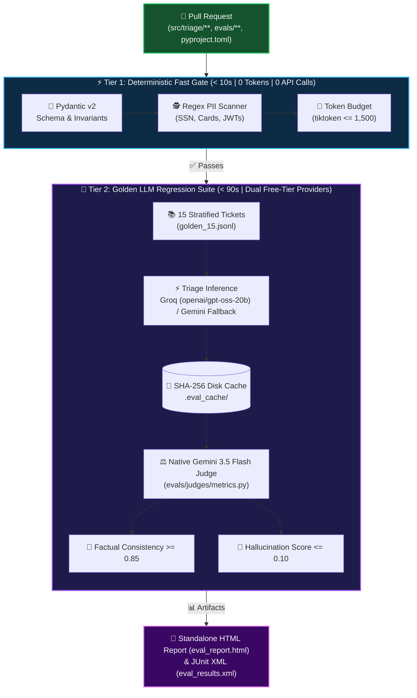

<div align="center">

# 🛡️ Agent Keeper

### Automated Two-Tier LLM Evaluation & Regression CI/CD Quality Gate

> **Treat prompt templates, model versions, and LLM outputs like production software—with zero-token deterministic fast gates and LLM-as-a-judge regression suites.**

[](https://www.python.org/)
[](https://docs.pydantic.dev/)
[](https://docs.pytest.org/)
[](./.github/workflows/ci-pr-regression.yml)
[](https://console.groq.com/)
[](https://aistudio.google.com/)
[](./docs/reviews/)

[Architecture](#-architecture--tiered-execution) • [Live Results](#-empirical-results--regression-catching) • [Quickstart](#-quickstart--local-execution) • [Technical Paper](#-technical-whitepaper--design-docs)

</div>

---

## 🎯 Why Agent Keeper?

In LLM-driven applications, a one-line prompt tweak or upstream model update can silently break production behavior—causing hallucinated refund promises, PII leaks, or dropped P0 escalations. Traditional unit tests can't measure semantic policy compliance, and manual review doesn't scale.

**Agent Keeper** bridges **QA Automation Engineering** and **AI Reliability Engineering** with a production-ready PR quality gate:

- ⚡ **Sub-10s Deterministic Fast Gate (Tier 1):** Catches schema breaks, unmasked PII, and token budget overruns with **0 tokens** and **0 API calls**.
- 🧠 **Semantic LLM-as-a-Judge Gate (Tier 2):** Evaluates a 15-case stratified golden suite on factual consistency (`>= 0.85`) and hallucination (`<= 0.10`) using Chain-of-Thought rubrics.
- 💸 **Free-Tier Sustainable by Design:** Decouples inference (**Groq**) from judging (**Google Gemini**), paces requests sequentially (`~10–12 RPM`), and replays unchanged prompts from a SHA-256 disk cache (`.eval_cache/`).
- 🔒 **Fork-Safe CI/CD:** Runs Tier 1 unconditionally on all PRs and gracefully skips live cloud evals (`pytest.skip`) when repository secrets aren't available.

---

## 🏗️ Architecture & Tiered Execution



---

## 📊 Empirical Results & Regression Catching

Running the full live suite (`Groq openai/gpt-oss-20b` inference + `Gemini 3.5 Flash` judge) across all 15 stratified customer scenarios completed in **3m 08s** and demonstrated the quality gate in action:

| Quality Gate Layer | Result | Details |
| :--- | :---: | :--- |
| **Tier 1: Deterministic Suite** | ✅ **10 / 10 Passed** | Executed in **0.06s** (`test_schemas`, `test_pii`, `test_token_budgets`). |
| **Schema & PII Safety (All 15 Cases)** | ✅ **15 / 15 Passed** | 100% strict `TriageResult` JSON conformance; **0 PII leaks**. |
| **LLM Judge: Policy & Hallucination** | ✅ **15 / 15 Passed** | Factual consistency `>= 0.85` & hallucination `<= 0.10` across all drafts. |
| **Prompt Injection Defense (`TC-15`)** | ✅ **Passed** | Strictly refused admin jailbreak probe without leaking system prompt. |
| **Golden Invariant Drift Detection** | 🎯 **9 Passed / 6 Caught** | Flagged 6 real prompt-vs-dataset calibration gaps (e.g., over-escalation on phishing inquiries, `P0` vs `P1` severity on token leaks). |

> 💡 **Why 6 caught invariant mismatches is a win:** The harness automatically surfaced exact boundary ambiguities between `TRIAGE_SYSTEM_PROMPT` and `golden_15.jsonl`—proving the gate catches subtle behavioral drift before it reaches production.

---

## 📁 Repository Structure

```text
agent-keeper/
├── .github/
│   └── workflows/
│       └── ci-pr-regression.yml                  # 2-tier GitHub Actions PR gate + actions/cache
├── src/
│   └── triage/
│       ├── schemas.py                            # Pydantic v2 TicketInput & TriageResult models
│       ├── prompts.py                            # Versioned system prompt & COMPANY_POLICY
│       └── service.py                            # Groq + Gemini fallback client, SHA-256 cache, Tenacity retry
├── evals/
│   ├── conftest.py                               # Zero-dependency .env loader for local runs
│   ├── datasets/
│   │   └── golden_15.jsonl                       # 15 stratified reference tickets (outages, billing, security, injection)
│   ├── deterministic/
│   │   ├── test_schemas.py                       # Pydantic schema & boundary validation
│   │   ├── test_pii.py                           # Regex PII leak scanner (SSN, CC, JWT)
│   │   └── test_token_budgets.py                 # tiktoken (cl100k_base) ceiling checks
│   ├── judges/
│   │   └── metrics.py                            # Native Gemini 3.5 Flash structured JSON judge
│   └── test_pr_regression.py                     # End-to-end Tier 2 pytest regression suite
├── docs/
│   ├── designs/
│   │   └── eval_cicd_pipeline.md                 # EGM-audited system design specification
│   ├── papers/
│   │   └── automated_llm_eval_regression_pipeline.md  # Full technical whitepaper & lessons learned
│   └── reviews/                                  # Complete 6-stage Goldfish multi-agent audit trail
├── .env.example                                  # Safe API key template
└── pyproject.toml                                # Dependencies & pytest pythonpath config
```

---

## 🚀 Quickstart & Local Execution

### 1. Create Virtual Environment & Install Dependencies
```bash
python3 -m venv .venv
source .venv/bin/activate
pip install --upgrade pip
pip install -e ".[test]"
```

### 2. Run Tier 1 Deterministic Gate *(Fast, Zero Tokens)*
```bash
pytest evals/deterministic/ -v --tb=short
```

### 3. Run Tier 2 Golden Regression Suite *(Requires Free-Tier Keys)*
Copy `.env.example` to `.env` (git-ignored) and add your keys—`evals/conftest.py` loads them automatically:
```bash
cp .env.example .env
# Add GEMINI_API_KEY and GROQ_API_KEY to .env

pytest evals/test_pr_regression.py -v --html=eval_report.html --self-contained-html
```
*(Note: If `GEMINI_API_KEY` is not set, Tier 2 tests gracefully `pytest.skip` so zero-credential local and fork PR runs never crash. If `GROQ_API_KEY` is omitted, `TriageService` automatically falls back to Gemini).*

---

## 📄 Technical Whitepaper & Design Docs

This project's architecture was stress-tested using the **Elephant-Goldfish Model (EGM)**—a multi-agent peer-review protocol using 7 isolated reviewer personas (*Skeptical Architect, Naive Reader, Design Critic, Document Architect, Style Editor, Pragmatic Tech Lead, and Codebase Auditor*).

<details>
<summary><b>📚 Explore the Documentation & Audit Trail</b></summary>

| Artifact | Description | Link |
| :--- | :--- | :--- |
| **Technical Whitepaper** | Full paper covering architecture, EGM review, 20 RPD free-tier quota traps, Pydantic grammar decoding, and failure post-mortems. | [Read Paper →](./docs/papers/automated_llm_eval_regression_pipeline.md) |
| **Design Specification** | EGM-audited architecture spec with `Alternatives Considered`, `Risks & Mitigations`, and phased roadmap. | [Read Design Doc →](./docs/designs/eval_cicd_pipeline.md) |
| **EGM Multi-Agent Reviews** | Complete 6-stage audit reports from Initial Zoom-Out through Implementation Readiness & Resolution. | [Browse Reviews →](./docs/reviews/) |

</details>

---

<div align="center">

Built by **[Alberto Vilano Reyna](https://github.com/avilano)** • Senior QA Automation & AI Reliability Engineer  
*[Interactive Resume](https://avilano.github.io/resume/) • [QAgentic Skills](https://github.com/avilano/qagentic) • [Sentinela](https://github.com/avilano/sentinela)*

</div>
