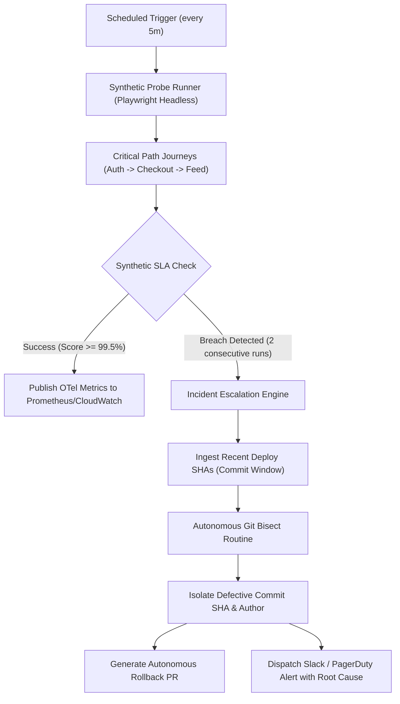

# Product & Technical Specification: CanaryOps
## Autonomous Synthetic Monitoring & Auto-Rollback Agent

**Status:** Draft / Source Blueprint  
**Version:** 1.0.0  
**Target Audience:** Staff/Principal SDET, Infrastructure & Reliability Engineering, DevEx  

---

## 1. Executive Summary & Business Justification

### 1.1 The Problem
In modern high-velocity continuous deployment environments (such as Circle, Stripe, or Vercel), pre-merge test suites cannot catch 100% of production anomalies. Configuration drifts, transient cloud service degradations, database read-replica lags, and third-party webhook partner timeouts occur *after* code reaches production. 

Traditional production monitoring relies on passive telemetry (Datadog APM, Sentry) and human on-call engineers. By the time an engineer is paged, triages the anomaly, identifies the faulty deployment commit, and executes a rollback, customer churn and SLA violations have already occurred.

### 1.2 The Solution
**CanaryOps** is a proactive, autonomous reliability agent that merges continuous synthetic journeys with autonomous root-cause remediation:
1. **Active Synthetic Ingestion:** Executes headless synthetic customer journeys (critical path onboarding, payment checkout, community interaction) every 5 minutes against production/canary environments.
2. **OpenTelemetry Correlation:** Captures distributed trace spans, response latency percentiles (p95/p99), and HTTP status codes.
3. **Autonomous Root-Cause Bisecting:** If consecutive synthetic health scores drop below a defined SLA threshold (e.g. `<99.5%` or p95 latency `>2500ms`), CanaryOps initiates an automated, non-destructive **git bisect** across the latest release commit window.
4. **Autonomous Remediation:** Generates an incident summary, posts a live alert with root-cause blame to Slack, and drafts an automated rollback Pull Request ready for one-click approval or auto-merge.



---

## 2. Product Requirements

### 2.1 User Personas
* **Site Reliability & Quality Engineers (SQEs):** Need zero-false-positive synthetic monitoring that doesn't rely on brittle UI scripts.
* **Release Managers & Product Engineers:** Need fast automated rollbacks when a canary deployment breaks critical user journeys.
* **Executive Engineering Leadership:** Requires verifiable SLA compliance reporting (MTTD and MTTR reduction).

### 2.2 Core User Stories
* **US-1 (Continuous Probing):** As an SQE, I want lightweight Playwright-driven synthetic probes to run every 5 minutes across global regions so that outages are detected before users report them.
* **US-2 (Trace Context):** As an on-call engineer, I want every failed synthetic probe to carry an OpenTelemetry `trace_id` linked directly to downstream microservice logs.
* **US-3 (Autonomous Bisecting):** As a developer who deployed code, I want the agent to automatically isolate which commit in a 10-commit release batch introduced a synthetic regression.
* **US-4 (Automated Rollback Safeguard):** As an infrastructure engineer, I want CanaryOps to generate a clean `git revert` PR with impact metrics, preventing unverified production code from lingering.

### 2.3 Non-Functional Requirements (NFRs)
* **Probe Execution Time:** Each synthetic probe run must complete within `< 45 seconds`.
* **Zero Production Footprint:** Probing accounts must use isolated, synthetic sandbox identities with automated state cleanup to avoid polluting production metrics.
* **Idempotency:** Probe runs must be completely idempotent—repeating a checkout probe must not charge real customer cards or leave pending carts locked.

---

## 3. Technical Architecture

### 3.1 System Component Breakdown

```
canary-ops/
├── probes/
│   ├── journeys/
│   │   ├── auth-session.probe.ts       # Sub-second token validation & session refresh
│   │   ├── checkout-funnel.probe.ts    # Synthetic payment gateway check with sandbox cards
│   │   └── feed-publication.probe.ts   # Creator community posting & retrieval latency
│   └── telemetry/
│       └── otel-tracer.ts              # OpenTelemetry span exporter & trace propagator
├── agent/
│   ├── anomaly-detector.ts             # Moving-window SLA calculator (p95, error rate)
│   ├── git-bisector.ts                 # Headless git bisect runner across deploy ranges
│   └── remediator.ts                   # GitHub API client generating rollback PRs
├── notifications/
│   └── slack-incident-reporter.ts      # Rich Slack block kit alert dispatcher
└── config/
    └── canary.config.ts                # SLA thresholds, probe intervals, and target URLs
```

### 3.2 Data Contracts & Schemas

#### Synthetic Metric Event Payload
```json
{
  "probeId": "probe_checkout_001",
  "timestamp": "2026-10-28T15:00:00Z",
  "environment": "production-canary",
  "region": "us-east-1",
  "durationMs": 1420,
  "status": "PASS",
  "traceId": "4bf92f3577b34da6a3ce929d0e0e4736",
  "spans": [
    { "step": "api_auth_seed", "durationMs": 42 },
    { "step": "cart_addition", "durationMs": 180 },
    { "step": "payment_gateway_ack", "durationMs": 890 }
  ],
  "slaThresholdMs": 2500
}
```

#### Incident Report Contract
```json
{
  "incidentId": "inc_20261028_0912",
  "failingJourney": "checkout-funnel.probe.ts",
  "consecutiveFailures": 2,
  "breachedSla": "p95_latency > 2500ms OR http_status >= 500",
  "culpritCommit": {
    "sha": "9a7fbc2",
    "author": "dev@company.com",
    "message": "refactor(payment): update Stripe webhook signature validation",
    "diffUrl": "https://github.com/company/repo/commit/9a7fbc2"
  },
  "rollbackPullRequest": "https://github.com/company/repo/pull/1429",
  "status": "AWAITING_APPROVAL"
}
```

---

## 4. Failure Modes & Safety Controls

| Risk | Mitigation Mechanism |
| :--- | :--- |
| **Flaky Network Blip** | Requires **2 consecutive failed probe runs** before triggering the escalation engine. |
| **Rollback Loops** | Maximum of **1 automated rollback PR per 24-hour cycle**; subsequent anomalies alert human on-calls. |
| **Synthetic Data Leak** | All synthetic resources carry prefix `[CANARY_SYNTHETIC]` and an auto-expiring TTL header (`X-Synthetic-TTL: 3600`). |

---

## 5. Development Milestones

1. **Phase 1 (Probe Core):** Implement Playwright headless probes with OpenTelemetry trace emission and zero UI-flakiness design.
2. **Phase 2 (Anomaly Engine):** Build the moving-average SLA calculator and multi-region runner.
3. **Phase 3 (Bisect & Remediation Agent):** Develop the autonomous git bisect worker and automated GitHub PR generator.
4. **Phase 4 (ChatOps & Observability Dashboard):** Connect Slack Block Kit alerts and Grafana metric dashboards.
