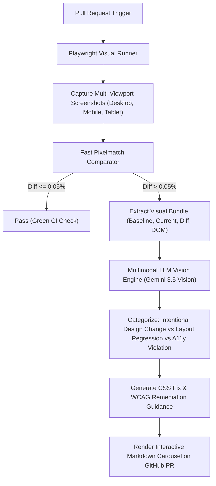

# Product & Technical Specification: VigilA11y
## Multimodal Visual Regression & Accessibility Intelligence Platform

**Status:** Draft / Source Blueprint  
**Version:** 1.0.0  
**Target Audience:** Staff/Principal SDET, Frontend Architects, Design System Engineers  

---

## 1. Executive Summary & Business Justification

### 1.1 The Problem
Visual regression testing tools (e.g. Percy, pixelmatch, BackstopJS) have a fundamental flaw: **they are dumb pixel diff engines**. 
When a component moves by 3 pixels or an anti-aliasing font shift occurs, traditional visual test suites highlight thousands of raw red pixels without understanding *why* the shift occurred or whether it represents a real design system bug or an accessibility violation. Engineers spend hours reviewing false-positive visual diffs, eventually leading to "diff fatigue" where actual regressions are rubber-stamped into production.

Furthermore, traditional accessibility checkers (e.g. axe-core) only evaluate the DOM code—they cannot visually assess overlapping text, cut-off mobile responsive elements, or visual tap targets that meet minimum pixel physical touch areas (WCAG 2.5.5 / 2.5.8).

### 1.2 The Solution
**VigilA11y** merges multi-device visual screenshot capture with **Multimodal Vision LLMs (Gemini Vision)**:
1. **Multi-Viewport Visual Capture:** Uses Playwright to capture pixel-perfect baseline vs. candidate screenshots across multi-device viewports (`Desktop 1440x900`, `Tablet 768x1024`, `Mobile 375x667`).
2. **Deterministic Threshold Gating:** Computes pixel divergence via `pixelmatch`. If divergence exceeds `0.1%`, the visual incident is triggered.
3. **Multimodal LLM Layout Reasoning:** Rather than dumping a red diff on developers, VigilA11y sends the **baseline image**, the **candidate image**, the **diff map**, and the **surrounding DOM layout tree** to a Multimodal Vision LLM.
4. **Natural-Language Impact Analysis:** The vision model explains:
   * *What actually shifted* (e.g. "Primary Call to Action shifted 28px downwards").
   * *The underlying CSS root cause* (e.g. "Missing margin-top reset on hero container").
   * *Accessibility compliance impact* (e.g. "Violates WCAG 2.5.8: Target size for mobile tap button is under 24x24 CSS pixels").
5. **Interactive PR Visual Carousel:** Posts a side-by-side interactive before/after visual review directly to the GitHub Pull Request.



---

## 2. Product Requirements

### 2.1 User Personas
* **Design System Engineers:** Need automated protection against unintended global CSS regressions across shared UI component libraries.
* **Accessibility Specialists:** Need automated visual auditing for responsive reflow (WCAG 1.4.10) and interactive tap target sizes.
* **Frontend Developers:** Want actionable explanations of why a visual test failed rather than inspecting a raw red image overlay.

### 2.2 Core User Stories
* **US-1 (Multi-Device Baselines):** As a frontend engineer, I want visual tests to automatically run across desktop, tablet, and mobile viewport presets so that responsive layouts are guaranteed.
* **US-2 (AI Visual Reasoning):** As a PR author, I want the bot to explain *why* the layout shifted in plain English instead of making me guess from a red pixel mask.
* **US-3 (Visual Accessibility Auditing):** As an SQE, I want the visual engine to flag when layout changes cause text truncation, contrast failure against dynamic backgrounds, or undersized touch targets.
* **US-4 (Baseline Management):** As a designer, I want a one-click CLI command (`npm run visual:approve`) to update verified baseline snapshots when intentional redesigns land.

### 2.3 Acceptance Criteria
1. Visual comparison must ignore system scrollbars and dynamic timestamps/dates.
2. Multimodal analysis must categorize every visual failure into one of three classifications:
   * `INTENTIONAL_REDESIGN`
   * `LAYOUT_REGRESSION`
   * `WCAG_A11Y_DEFECT`
3. The PR comment must include the visual before/after comparison alongside the suggested CSS adjustment.

---

## 3. Technical Architecture

### 3.1 Component Architecture

```
vigil-a11y/
├── runner/
│   ├── viewport-matrix.ts           # Screen presets: Mobile Safari (375x667), Desktop (1440x900)
│   ├── visual-snapshot.fixture.ts   # Custom Playwright fixture: page.toMatchVisualSnapshot()
│   └── dom-context-extractor.ts     # Extracts computed styles and bounding boxes of shifting nodes
├── vision-agent/
│   ├── image-comparator.ts          # Pixelmatch engine producing diff mask + percentage
│   ├── multimodal-client.ts         # Encodes images (base64) & prompts Gemini 3.5 Vision
│   └── visual-triage-parser.ts      # Validates structured JSON diagnosis from vision model
├── reporter/
│   ├── pr-carousel-commenter.ts     # Generates Markdown with side-by-side visual comparisons
│   └── visual-report-generator.ts   # Builds standalone HTML visual gallery
└── baseline-storage/
    └── .snapshots/                  # Git-LFS or cloud-backed baseline golden master PNGs
```

### 3.2 Vision Model Prompt & Payload Schema

```json
{
  "systemInstruction": "You are a Principal Frontend & Accessibility Architect reviewing visual diffs.",
  "prompt": "Compare the baseline and current UI screenshots. Analyze the provided DOM bounding box context and determine the root cause of visual divergence.",
  "images": [
    { "role": "baseline", "mime": "image/png", "data": "<base64_golden>" },
    { "role": "current", "mime": "image/png", "data": "<base64_candidate>" },
    { "role": "diff_mask", "mime": "image/png", "data": "<base64_diff>" }
  ],
  "expectedOutputSchema": {
    "category": "LAYOUT_REGRESSION | INTENTIONAL_REDESIGN | WCAG_A11Y_DEFECT",
    "divergencePercentage": 0.42,
    "shiftedElements": ["button#checkout-submit", "div.hero-title"],
    "visualObservation": "The primary checkout button has shifted 18px to the right and collapsed its height from 44px to 28px.",
    "wcagImpact": "Violates WCAG 2.5.8 (Target Size): Minimum tap area on touch devices must be at least 24x24px.",
    "suggestedCssPatch": "button.checkout-btn { min-height: 44px; margin-inline: auto; }"
  }
}
```

---

## 4. Edge Cases & Resilience Strategy

| Edge Case | Solution |
| :--- | :--- |
| **Font Anti-Aliasing on CI Runners** | Ubuntu vs macOS font rendering differences are neutralized via Dockerized test runs or a `threshold: 0.2` per-pixel tolerance in `pixelmatch`. |
| **Dynamic Animations / Carousels** | Auto-inject CSS rule `*, *::before, *::after { animation-duration: 0s !important; transition: none !important; }` before snapshot capture. |
| **Large Snapshot Repository Size** | Use **Git LFS** or S3 bucket baseline storage with SHA-keyed image caching to avoid git repository bloat. |

---

## 5. Development Milestones

1. **Phase 1 (Visual Fixture):** Implement `toMatchVisualSnapshot` Playwright custom fixture with pixelmatch & dynamic animation disabling.
2. **Phase 2 (DOM Context Ingestion):** Capture element bounding client rects and computed styles for shifted elements.
3. **Phase 3 (Multimodal Vision Hook):** Connect Gemini 3.5 Vision to ingest the image trio and output structured visual root-cause diagnostics.
4. **Phase 4 (Interactive PR Reviewer):** Post interactive before/after image comparisons with CSS patch suggestions directly into GitHub Pull Requests.
